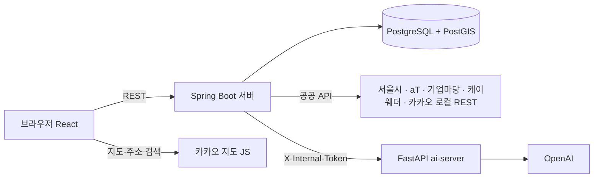
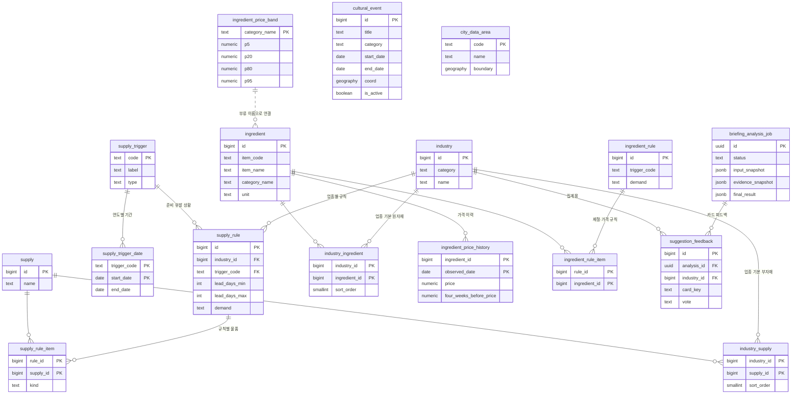

# 기획서 피드백 반영 (붙여 넣기용)

심사 피드백 가운데 이미 설계돼 있어 기획서에 적기만 하면 되는 항목을 모았습니다. 레포 문서·코드에 있는 내용만 옮겼고, 정해지지 않은 것은 **결정 필요**, 레포에서 확인하지 못한 것은 **확인 필요**로 표시했습니다. 기준일: 2026-11-21.

## 1. 기술 구성

| 영역 | 기술 | 배포 |
| --- | --- | --- |
| 프론트 | React 19 + TypeScript + Vite (CSR SPA), Ant Design, Tailwind, TanStack Query | Cloudflare Pages (무료), `main` 브랜치, 루트 `frontend` |
| 서버 | Spring Boot 4.1 (Java 25) | Render 무료 웹 서비스 `hackathon-server` (Docker, 싱가포르) |
| AI 서버 | Python FastAPI (`POST /v1/analyze`) | Render 무료 웹 서비스 `hackathon-ai-server` (Docker, 싱가포르) |
| DB | PostgreSQL + PostGIS | Neon 무료 (AWS 싱가포르) |
| LLM | OpenAI GPT 6.2 Astra | ai-server만 호출 |



- 공공 API는 모두 **서버에서** 부릅니다: 서울시 문화행사(OA-23041)·실시간 도시데이터(OA-21285), aT 가격 추이(data.go.kr 15156069), 기업마당 지원사업(15157820), 케이웨더, 카카오 로컬 REST. 인증키는 Render 환경변수에만 둡니다.
- 브라우저가 직접 부르는 외부 서비스는 **카카오 지도 JS**뿐입니다(공개용 JS 키, 도메인 등록). REST 키는 서버에만 둡니다.
- ai-server는 Java 서버만 부르고, 두 서버가 같은 `AI_SERVER_TOKEN`을 헤더로 확인합니다.
- LLM은 OpenAI **GPT 6.2 Astra**를 써요. 키와 모델 이름은 ai-server 환경변수 `LLM_API_KEY`·`LLM_MODEL`로 넣어요.
- **확인 필요:** `LLM_MODEL`에 넣을 정확한 API 모델 이름, 구조화 출력(`json_schema` strict) 지원, temperature 지원 여부. 프롬프트 초안은 temperature 0.2~0.3으로 결과를 안정시키는데, 이 값을 받지 않는 모델이면 초안을 고쳐야 해요.

근거: `render.yaml`, `frontend/README.md`, `server/README.md`, `server/build.gradle`, `ai-server/.env.example`, `ai-server/docs/API_CONTRACT_DRAFT.md`, `ai-server/docs/PROMPT_DRAFT.md`

## 2. LLM 입력·출력

분석 4단계 중 앞의 셋(가게 정보 확인, 주변 행사 조회, 품목 가격 조회)은 Java가, 마지막 "준비할 일 정리"만 Python이 LLM으로 합니다. 숫자(거리·가격·변동률·준비 시점)는 Java가 계산해 넘기고, LLM은 그 숫자로 문장만 만듭니다.

**요청 (Java → Python, 일부 필드)**

| 필드 | 내용 |
| --- | --- |
| `store` | 자치구, 생활권 이름, 업종, 운영 방식. **가게 이름·상세 주소는 보내지 않아요**(개인정보). |
| `events[]` | 근거 id(`E1`…), 행사명, 분류, 날짜, 거리(m), 도보 시간 |
| `raw_materials[]` | 근거 id(`R1`…), 품목 id, 조사 가격, 1주·4주 변동률, 흐름(`UP`·`DOWN`·`FLAT`) |
| `supplies[]` | 근거 id(`S1`…), 품목 id, 준비 마감일, 수요 방향 |

**응답 (Python → Java, 추천 1건)**

```json
{ "category": "RAW_MATERIAL", "item_id": 12, "title": "배추 거래처 단가 확인",
  "expected_effect": "다음 발주 전에 단가 변동을 미리 확인할 수 있어요.", "evidence_ids": ["R1"] }
```

- 제목 24자, 기대 효과 60자 이내, 근거 id 1개 이상. 단정하지 않는 해요체("~수 있어요").
- 출력은 OpenAI 구조화 출력(JSON Schema)으로 받고 Pydantic으로 다시 검사해요.
- 개편안(아래 5절)에서는 응답이 `card_id`·`title`·`expected_effect`·`sub_tasks`(세부 할 일 2~3개)로 바뀌어요.

| 항목 | 값 |
| --- | --- |
| 타임아웃 | Python의 LLM 호출 40초, Java의 응답 대기 60초 |
| 재시도 | 형식이 틀리면 Python이 오류 내용을 붙여 **1번만** 다시 요청. Java는 재시도하지 않고 화면의 [다시 시도]에 맡겨요. |
| 실패 | 401 토큰 오류, 422 요청 오류, 502 출력 규칙 위반, 503 LLM 오류·키 없음, 504 40초 초과. Java는 모두 "4단계 실패"로 기록하고 "브리핑을 만들다가 멈췄어요" + [다시 시도]를 보여 줘요. |

근거: `ai-server/docs/API_CONTRACT_DRAFT.md`, `ai-server/docs/PROMPT_DRAFT.md`

## 3. 지오코딩과 지역 연결

| 단계 | 담당 | 방식 |
| --- | --- | --- |
| 주소 검색 | 프론트 | 카카오 지도 JS로 주소를 찾고 도로명 주소·위도·경도를 얻어요. |
| 주소 확인 | 서버 | `POST /api/locations/validate` (도로명 주소·위도·경도). 항상 200이고, 서울 밖이면 `valid=false` + "서울 밖 주소는 아직 지원하지 않아요." |
| 분석 요청 | 서버 | `POST /api/analysis`에서 서울 여부를 **한 번 더** 확인해요(서울 밖 422). |
| 좌표 → 행정동 | 서버 | 카카오 로컬 REST `coord2regioncode`(`KakaoLocalClient`). 행정동 코드 10자리는 케이웨더 날씨 조회에 그대로 써요. |
| 주변 행사 | 서버 | PostGIS `ST_DWithin`·`ST_Distance`(미터)로 가게 1.5km 안 행사를 찾아요. |

- 서울 여부를 어떤 값으로 판정하는지(행정동의 시·도 이름 등)는 API 구현이 본선이라 **확인 필요**.

**실시간 도시데이터 장소와 가게 연결**

- 장소는 `city_data_area`(서울시 주요 장소, 지역 경계 `boundary` MultiPolygon, GiST 인덱스)에 있어요. 경계는 "영역 포함 여부와 거리 계산에 사용"하도록 만들어 뒀어요.
- 현재 설계: 대시보드 "지금 이 지역은 어떤가요?"에서 `GET /api/areas`(장소 이름·중심 좌표) 목록 중 장소를 골라 `GET /api/seoul/city-data/{area}`로 혼잡도·인구·날씨를 봐요. 지역 현황은 AI 브리핑과 분리돼 LLM에 보내지 않고 강추 점수에도 쓰지 않아요.
- **결정 필요:** 가게 위치로 처음 보여 줄 장소를 고르는 규칙은 문서에 없어요. 제안: 가게 좌표가 어떤 장소 경계 안에 들면 그 장소, 아니면 경계까지 가장 가까운 장소(`ST_Distance`). 너무 멀면(예: 2km 초과) 고르게 할지도 함께 정해요.
- **확인 필요:** 브리핑의 생활권 표시 이름(`areaLabel`, 예: "성수동 · 서울숲 인근")을 무엇으로 만드는지 정해진 규칙이 없어요.

근거: `server/src/main/java/com/hackathon/server/location/`, `server/src/main/java/com/hackathon/server/publicdata/KakaoLocalClient.java`, `server/src/main/java/com/hackathon/server/area/AreaResponse.java`, `server/src/main/java/com/hackathon/server/analysis/AnalysisRequest.java`, `docs/api-dtos.md`, `docs/database-schema.md`

## 4. 데이터 구조

업무 테이블 17개입니다(관리용 `batch_job`·`batch_job_history`·`flyway_schema_history`·`spatial_ref_sys` 제외). 컬럼은 주요한 것만 적었습니다.



- `cultural_event`·`city_data_area`는 외래 키 대신 좌표(PostGIS)로 가게와 연결해요.
- `ingredient_price_band`는 외래 키 없이 `ingredient.category_name`(부류)으로 찾아요.

**저장 위치 (로그인이 없을 때)**

| 데이터 | 저장 위치 | 설명 |
| --- | --- | --- |
| 분석 결과 | 서버 DB `briefing_analysis_job` | 분석이 1분쯤 걸려 POST로 시작하고 GET으로 다시 물어요. Render 무료 인스턴스가 재시작돼도 남게 DB에 둬요. 분석 번호가 UUID라 추측하기 어려워 조회 토큰은 두지 않아요. |
| 도움돼요·해당 없어요 | 서버 DB `suggestion_feedback` | 분석 1건의 카드 1장에 1표, 다시 누르면 표를 바꿔요. 업종 × 유형별로 집계해요. |
| 할 일(오늘 확인할 일) | 브라우저 localStorage `todos:{analysisId}` | 서버 API가 없어요. 강추 카드의 세부 할 일을 처음 열 때 담아요. |
| "해당 없어요" 제외 목록 | 브라우저 localStorage | 다음 `POST /api/analysis`의 `excludedKeys`로 보내 그 카드를 빼요. |

근거: `docs/database-schema.md`, `docs/database-erd-summary.md`, `docs/api-dtos.md`, `server/src/main/resources/db/migration/V19__supply_trigger_date.sql` (`supply_trigger_date`는 두 문서에 표가 없어 마이그레이션에서 옮김)

## 5. AI가 맡는 일과 검증

| 정하는 것 | 담당 |
| --- | --- |
| 근거 모으기(행사 E·시즌 H·날씨 W·원자재 R·부자재 S)와 근거 점수 | 서버 규칙 |
| 카드 칸: 묶음, 할 일 유형, 품목, 근거 id, 묶음 안 순서, 개수, 제외 | 서버 규칙 |
| 강추: 모든 추천 중 근거 점수 상위 3개(같은 유형 최대 2개) | 서버 규칙 |
| 한 줄 사유(`reason`, 예: "배추가 1주 전보다 4.1% 올랐어요.") | 서버 템플릿 |
| 할 일 제목, 기대 효과, 세부 할 일 2~3개 | **AI** (업종·운영 방식·상황을 종합해 문장으로) |

- 근거 점수 = 급한 정도 + 영향 크기 + 확실성(각 0~3점, 최대 9점). LLM은 점수·순위를 바꾸지 않아요.
- AI가 더하는 가치: 같은 "행사 650m · 배추 4.1% 상승"이라도 한식당·미용실·편의점마다, 매장·배달 운영마다 할 일이 달라요. AI는 서버가 고른 근거를 그 가게에 맞는 **바로 할 수 있는 행동 문장**과 순서 있는 세부 할 일로 바꿔 줘요. 업종 28개 × 할 일 유형 × 상황 조합을 규칙 문장으로 다 쓰기는 어려워요.

**원자료 대조(검증) 절차**

1. 서버가 근거마다 짧은 id(`E1`, `R1`…)를 붙여 보내요.
2. Python: 길이·개수, 입력에 없는 숫자를 검사해요. 어기면 오류를 붙여 1번 다시 요청해요. 프롬프트에도 "입력에 없는 숫자·날짜·가격·방문객 수를 만들지 않는다"를 넣고, "출력의 모든 숫자가 입력에 있음"을 테스트로 자동 확인해요.
3. Java: 저장 전에 한 번 더 걸러요. 입력에 없는 근거 id·품목 id, 근거 행사에 없는 할 일 유형을 단 추천은 버려요(개편안에서는 요청에 없는 `card_id`를 버려요).
4. 걸러서 하나도 안 남으면 4단계 실패로 처리하고 [다시 시도]를 보여 줘요.
5. 입력 근거와 점수(`evidence_snapshot`), 점수표 버전(`score_version`), 최종 결과(`final_result`)를 분석마다 저장해 나중에 대조할 수 있어요.

- 참고: 커밋된 계약 초안은 LLM이 할 일 유형과 묶음 안 순서를 고르는 방식이고, "서버가 칸을 정하고 AI는 문장만" 쓰는 개편안은 `SUGGESTION_TODOS_DRAFT.md`(메인 체크아웃에 아직 커밋 전)에 있어요. 서버 DTO(`SuggestionResponse`의 `reason`·`subTasks`)는 개편안 기준이에요. 계약 문서 반영은 **확인 필요**.

근거: `ai-server/docs/API_CONTRACT_DRAFT.md` ("Java 쪽 검증", "강추 고르기"), `ai-server/docs/PROMPT_DRAFT.md`, `ai-server/docs/SUGGESTION_TODOS_DRAFT.md`, `server/src/main/java/com/hackathon/server/analysis/SuggestionResponse.java`, `docs/database-schema.md`

## 6. 원재료 가격 신호 기준

정부 **농산물 수급조절매뉴얼의 7단계**(상승 심각·경계·주의 / 안정 / 하락 주의·경계·심각)를 따릅니다. 고정 %가 아니라 **부류별 4주 변동률 분위수**로 나눕니다.

| 단계 | 4주 변동률 위치(부류 안) | 구매 권장 방향 |
| --- | --- | --- |
| 상승 심각 | 상위 5% | 강한 구매 미권장 |
| 상승 경계 | 상위 12.5% | 강한 구매 미권장 |
| 상승 주의 | 상위 20% | 구매 미권장 |
| 안정 | 그 사이 | 가격 신호 없음 |
| 하락 주의 | 하위 20% | 구매 권장 |
| 하락 경계 | 하위 12.5% | 강한 구매 권장 |
| 하락 심각 | 하위 5% | 강한 구매 권장 |

- 4주 변동률 = 조사일 가격 ÷ 4주 전 평균 가격 − 1.
- 경계값은 `ingredient_price_band`에 부류별로 저장해요. aT 가격 추이 API의 2019-01~2026-11 조사일을 2주 간격으로 받아 계산했고, 표본은 부류별 892~5,423개(합계 15,798개)예요.
- 고정 %를 쓰지 않는 이유: 같은 10% 상승이라도 채소류는 "안정"(상위 20% 경계 +13.1%), 축산물은 "상승 심각"(상위 5% 경계 +8.7%)이에요. 4주 ±10%에 채소류는 46%, 축산물은 6.5%가 걸려요.
- 매뉴얼은 평년 대비 가격을 보지만, 5년 평년은 물가 상승이 섞이고 원자재 118개 중 67개만 5년 가격이 이어져서 모든 품목에 있는 4주 변동률을 써요.
- 1주 변동은 화면의 가격 흐름으로만 보여 주고 점수에 넣지 않아요. 경계값은 매년 초 다시 계산해요.
- 단계 판정 로직은 본선에서 구현해요.

근거: `docs/database-schema.md` (`ingredient_rule`, `ingredient_price_band`), `server/src/main/java/com/hackathon/server/analysis/PriceStage.java`, `PriceBand.java`

## 7. 시연 범위와 대비

- 시연은 **음식점(한식·국밥) 흐름**을 먼저 보여 줘요. 예시 가게는 성수동 한식당(서울 성동구 서울숲2길 32, 매장+배달)이에요. 계약·프롬프트 초안의 예시는 주변 행사 서울숲 음악회(650m), 원자재 배추·돼지고기·쌀, 부자재 포장 용기이고, 실제 시연 데이터는 미리 받아 둔 성수동 데이터로 바뀌어요.
- 공공 API 실패 대비: 성수동 예시 가게의 공공 데이터를 미리 받아 두고, 시연 중 API가 실패하면 그 데이터로 보여 줘요. 데이터 준비는 별도 작업으로 진행 중이에요(저장 위치·전환 방식은 **확인 필요**).
- 이미 있는 대비: 문화행사(18,838건)는 DB에 적재해 두고 분석 때 DB에서 골라요. 원자재 가격 이력은 로컬 DB에만 적재돼 있어 배포 DB(Neon) 적재는 **확인 필요**. LLM 실패는 [다시 시도]로 받아요.
- **확인 필요:** Render 무료 인스턴스는 한동안 요청이 없으면 잠들어 첫 요청이 느릴 수 있어요. 시연 직전에 서버·ai-server를 한 번씩 깨워 두는 게 좋아요.

근거: `ai-server/docs/PROMPT_DRAFT.md` ("예시"), `server/src/main/java/com/hackathon/server/analysis/AnalysisRequest.java`, `docs/database-schema.md`

## 8. 다음 단계 (지금은 범위 밖)

| 항목 | 지금 | 다음 |
| --- | --- | --- |
| 과거 비슷한 행사 때 유동인구 변화 | 행사 일정·거리만 근거로 써요. 혼잡도는 대시보드에만 보여 줘요. | 과거 행사 날의 인구 변화로 영향 크기를 보정 |
| 실제 매입 단가와 메뉴 원가 | aT 조사 가격(대표 규격)과 변동률만 써요. 구매 수량은 계산하지 않아요. | 사장님 매입 단가 입력, 메뉴별 원가 계산 |
| 중요한 변화 알림 | 사장님이 리포트를 만들 때만 분석해요. | 가격 단계 급변·근처 행사 등록 시 알림 |
| 실제 가게 사용 결과 | 시연용 예시 가게 | 실제 가게 사용 후 결과 수집 |

- "브리핑 뒤 실제로 어땠는지"는 카드마다 **도움돼요·해당 없어요** 피드백(V25, `suggestion_feedback`)으로 일부 대응해요. "해당 없어요"는 다음 분석에서 그 카드를 빼고, 표가 20개 이상 모인 업종 × 유형 조합만 강추 점수를 ±1 보정할 계획이에요(집계는 본선). 모델을 재학습하지 않으므로 "AI가 학습한다"가 아니라 "사장님 피드백을 반영해 추천이 좋아진다"고 말해요.

근거: `ai-server/docs/API_CONTRACT_DRAFT.md`, `ai-server/docs/SUGGESTION_TODOS_DRAFT.md` ("피드백"), `docs/database-schema.md` (`suggestion_feedback`, "평가 근거")

## 9. 배포 주소

| 대상 | 주소 |
| --- | --- |
| 서비스(프론트) | **결정 필요** (Cloudflare Pages `https://<프로젝트>.pages.dev`) |
| 서버 API 문서 | **결정 필요** (`https://<서비스>.onrender.com/swagger-ui.html`) |
| 소스 | **결정 필요** |

근거: `frontend/README.md` ("배포"), `server/README.md` ("배포")
